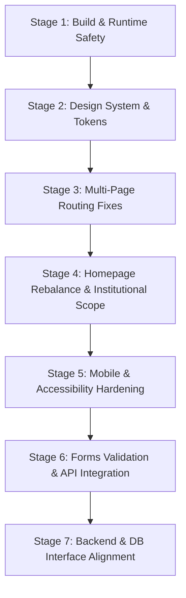

# Insight Ignite — Complete Frontend Audit and Stabilization Plan

**Document ID:** `AUDIT-2026-10-19-FE`  
**Date:** October 19, 2026  
**Auditor:** Senior Frontend & QA Architecture Team  
**Scope:** Frontend Workspace (`frontend/`), Monorepo Contracts (`shared/`), Integration Interfaces (`backend/`, `database/`)  
**Status:** Audit Completed — Awaiting Review Before Implementation

---

## 1. Executive Summary & System Context

Insight Ignite is an educational and developmental mentorship organization led by Dr. Nivedita Ganguli. Its institutional scope encompasses five distinct pillars:
1. **Parenting & Family Life** (Inaugural paid course: *The 6 Powers of Conscious Parenting*)
2. **Students & Adolescents** (Resilience & self-regulation workshops)
3. **Educators & School Development** (Classroom observation & pedagogical mentorship)
4. **Corporate Development** (Emotional resilience & leadership presence)
5. **Educational Resources** (Toolkits, conversation prompts, and reflection guides)

### Current Architecture & Stack Status
- **Monorepo Structure:** npm workspaces (`frontend`, `backend`, `database`, `shared`).
- **Core Technology:** Next.js 16.4.2 (Turbopack, App Router, React 19.3.0, TypeScript 5, Tailwind CSS v4).
- **Backend / DB Status:** Express API and Prisma ORM schemas are scaffolded in isolated packages, currently uncoupled from frontend production runtime.
- **Verification Baseline:**
  - `npm run lint`: **0 errors, 0 warnings** across workspaces.
  - `npm run build:frontend`: **32/32 routes compiled and statically prerendered** without compiler errors.
  - HTTP Availability: **18 verified endpoints return HTTP 200 OK**.

### Core Audit Finding
While the site builds cleanly and responds across all routes, **architectural, visual, and interaction defects prevent it from functioning as a polished, institution-grade multi-page platform**. The root homepage remains over-indexed on a single parenting course, several legacy `#` anchor links persist, forms operate on simulated client-only timers, and real visual assets have not yet replaced placeholder SVG geometry.

---

## 2. Test Execution & Runtime Diagnostics

### 2.1 Build & Lint Diagnostics (Executed October 19, 2026)

```bash
> npm run lint --workspaces --if-present
> @insight-ignite/frontend@0.1.0 lint
> eslint
# Output: Clean (0 errors, 0 warnings)

> npm run build --workspace=@insight-ignite/frontend
▲ Next.js 16.4.2 (Turbopack)
✓ Compiled successfully in 829ms
  Finished TypeScript in 1900ms
✓ Generating static pages using 15 workers (32/32) in 1867ms
# Output: 32/32 pages generated successfully
```

### 2.2 Route Verification Matrix

| Route | Type | HTTP Status | Visual / Navigation Status |
| :--- | :--- | :--- | :--- |
| `/` | Static | 200 OK | Operational; but contains legacy single-page anchor sections. |
| `/about` | Static | 200 OK | Operational; displays Dr. Ganguli profile and governance policy. |
| `/programs` | Static | 200 OK | Operational; grid of 5 pillars. |
| `/programs/[slug]` | Dynamic (SSG) | 200 OK | Operational; displays individual pillar deep-dives and breadcrumbs. |
| `/courses` | Static | 200 OK | Operational; shows academy masterclass catalogue. |
| `/courses/[slug]` | Dynamic (SSG) | 200 OK | Operational; full syllabus for *The 6 Powers*. |
| `/resources` | Static | 200 OK | Operational; downloadable guide cards and request links. |
| `/contact` | Static | 200 OK | Operational; client form UI present; submission is simulated. |
| `/login` | Static | 200 OK | Operational; UI input shell with client-side notice. |
| `/register` | Static | 200 OK | Operational; multi-role selector with password verification. |
| `/verify-email` | Static | 200 OK | Operational; informational notice. |
| `/forgot-password` | Static | 200 OK | Operational; simulated email dispatch notice. |
| `/learn` | Static | 200 OK | Operational; learner dashboard shell. |
| `/learn/courses/[courseId]` | Dynamic (SSG) | 200 OK | Operational; classroom room overview with module list. |
| `/learn/.../lessons/[lessonId]` | Dynamic (SSG) | 200 OK | Operational; lecture player placeholder and worksheets. |
| `/admin` | Static | 200 OK | Operational; management KPI dashboard. |
| `/legal/privacy` | Static | 200 OK | Operational; child data protection policy. |
| `/legal/terms` | Static | 200 OK | Operational; platform terms and governance. |
| `/legal/refunds` | Static | 200 OK | Operational; cancellation & refund rules. |
| `/api/health` | Dynamic API | 200 OK | Operational; JSON health payload returned. |

---

## 3. Prioritized Issue Registry

### High Severity Defects

#### `AUD-001`: Root Metadata Over-Indexes on Parenting Instead of Institutional Scope
- **File / Route:** `frontend/src/app/layout.tsx` (lines 22–35)
- **Severity:** High
- **Description:** Root metadata title is set to `"Insight Ignite — Dr. Nivedita Ganguli | Conscious Parenting Platform"`. This misrepresents Insight Ignite as purely a parenting website, conflicting with its broader mandate across student mentoring, school educator development, and corporate leadership.
- **Evidence:** Inspecting `<title>` in browser DOM shows `Conscious Parenting Platform` on all pages that do not override title templates.
- **Recommended Correction:** Update root title template to:
  ```ts
  title: {
    default: "Insight Ignite — Educational & Developmental Mentorship | Dr. Nivedita Ganguli",
    template: "%s | Insight Ignite"
  }
  ```
- **Verification Method:** Inspect DOM `<title>` on `/` and `/programs`.

---

#### `AUD-002`: Legacy Single-Page Anchor Links Persist in Primary CTA Buttons
- **File / Route:**
  - `frontend/src/features/home/components/Hero.tsx` (line 68)
  - `frontend/src/features/courses/components/FeaturedCourse.tsx` (line 131)
- **Severity:** High
- **Description:** 
  1. `Hero.tsx` secondary button links to `href="#about"` instead of Next.js multi-page route `<Link href="/about">`.
  2. `FeaturedCourse.tsx` CTA links to `href="#six-powers"` instead of `<Link href="/courses/the-6-powers-of-conscious-parenting">`.
- **Evidence:** Clicking "Meet Dr. Nivedita Ganguli" on the homepage jumps down the same page rather than navigating to the dedicated `/about` route.
- **Recommended Correction:** Replace raw `<a>` tags with `next/link` components referencing `/about` and `/courses/the-6-powers-of-conscious-parenting`.
- **Verification Method:** Click hero and featured course CTAs in browser; confirm URL updates to `/about` and `/courses/...`.

---

#### `AUD-003`: Homepage Architecture Over-Duplicates Course Content
- **File / Route:** `frontend/src/app/(public)/page.tsx`
- **Severity:** High
- **Description:** The homepage currently mounts `Hero`, `PillarsSection`, `Biography`, `FeaturedCourse`, `SixPowers`, `LearningOutcomes`, `CourseJourney`, and `FAQSection`. This makes ~75% of the homepage vertical height dedicated exclusively to "The 6 Powers of Conscious Parenting", duplicating content that already exists on `/courses/the-6-powers-of-conscious-parenting`. The homepage fails to adequately introduce the other 4 institutional pillars.
- **Evidence:** Homepage height is >7,000px, predominantly covering parenting course modules, outcomes, and journey steps.
- **Recommended Correction:**
  1. Streamline homepage to feature: Hero (Institutional Mission) &rarr; 5 Pillars Overview &rarr; Founder Leadership (`Biography`) &rarr; Featured Course Card (*The 6 Powers* with CTA to full syllabus) &rarr; Organizational FAQ &rarr; Institutional Inquiries CTA.
  2. Ensure the deep-dive syllabus, individual power modules, learning outcomes, and course journey live on `/courses/the-6-powers-of-conscious-parenting`.
- **Verification Method:** Visual audit of homepage length and balanced institutional presentation.

---

#### `AUD-004`: Contact Form Uses Simulated Success State Without Validation or API Dispatch
- **File / Route:** `frontend/src/app/(public)/contact/page.tsx` (lines 17–21, 60–80)
- **Severity:** High
- **Description:** Submitting the contact form immediately toggles a client boolean `setSubmitted(true)` without validating input format against contracts or dispatching to an API endpoint (`/api/contact`). If an error occurs or the client loses network connectivity, the user is still given false confirmation that their inquiry was delivered.
- **Evidence:** Form submission triggers instantaneous success UI without network activity in DevTools.
- **Recommended Correction:**
  1. Create a Next.js App Router API route `frontend/src/app/api/contact/route.ts` validating inputs with `@insight-ignite/shared` schema.
  2. Implement pending loading states (`isSubmitting`), error toast/alert on failure, and real server-verified confirmation.
- **Verification Method:** Submit form with network disabled (confirm error alert); submit with valid inputs (confirm 200 response in network tab).

---

### Medium Severity Defects

#### `AUD-005`: Mobile Navigation Drawer Lacks Keyboard Trap and Escape Key Listener
- **File / Route:** `frontend/src/components/layout/Navbar.tsx` (lines 159–193)
- **Severity:** Medium
- **Description:** When the mobile navigation menu is opened on viewports <768px, focus is not trapped within the drawer. Pressing `Escape` does not dismiss the menu, and background elements remain focusable via Tab navigation, violating WCAG 2.1 AA keyboard accessibility guidelines.
- **Evidence:** Open mobile menu, press `Tab` repeatedly; focus moves into the hidden page content behind the drawer.
- **Recommended Correction:** Add an `useEffect` listener for `keydown (Escape)` and apply `aria-modal="true"` with a focus trap or lock.
- **Verification Method:** Open mobile menu on mobile viewport, press `Escape`, verify drawer closes and focus returns to hamburger button.

---

#### `AUD-006`: Footer Anchor Attribute `id="contact"` Clashes with Public Route `/contact`
- **File / Route:** `frontend/src/components/layout/Footer.tsx` (line 7)
- **Severity:** Medium
- **Description:** The footer element is tagged with `id="contact"`. In the legacy single-page setup, links jumped to `#contact`. Now that a dedicated `/contact` page exists, this duplicate anchor can cause browser confusion on page load when hashes are present.
- **Evidence:** `<footer id="contact" ...>` in HTML DOM.
- **Recommended Correction:** Remove `id="contact"` from `Footer.tsx`. Use semantic `<footer>` without ID.
- **Verification Method:** Confirm HTML validation and anchor jump behavior.

---

#### `AUD-007`: Reusable Design System Primitives (`Button`, `Card`) Underutilized
- **File / Route:** `frontend/src/components/ui/Button.tsx`, `frontend/src/components/ui/Card.tsx`
- **Severity:** Medium
- **Description:** Core components [Button.tsx](file:///D:/website/frontend/src/components/ui/Button.tsx) and [Card.tsx](file:///D:/website/frontend/src/components/ui/Card.tsx) were created with proper design tokens, but several pages still use ad-hoc inline Tailwind class strings (`px-6 py-2.5 rounded-full bg-[#8C5E42]...`), creating visual inconsistency and code duplication.
- **Evidence:** Grep shows `<button>` elements with divergent padding (`py-2.5` vs `py-3` vs `py-3.5`) across `/login`, `/register`, and `/contact`.
- **Recommended Correction:** Refactor form actions and card containers across auth and contact pages to use the standardized `<Button>` and `<Card>` primitives.
- **Verification Method:** Visual inspection of button heights and focus rings across all forms.

---

#### `AUD-008`: Missing Static Graphic Assets in `frontend/public/images/`
- **File / Route:** `frontend/public/images/{branding, programs, courses, team}`
- **Severity:** Medium
- **Description:** All photography, instructor portraits, and program hero artworks currently use inline SVG silhouettes or CSS gradient blocks. While this avoids 404 image errors, it produces an unfinished aesthetic for the founder biography and course showcase.
- **Evidence:** `frontend/public/images/` contains 0 image files.
- **Recommended Correction:** Place high-resolution, approved WebP assets in `frontend/public/images/` and use Next.js `<Image>` with priority loading and explicit aspect ratios.
- **Verification Method:** Verify network tab loads optimized `.webp` images with correct alt attributes.

---

### Low Severity / Code Hygiene Observations

#### `AUD-009`: Standalone Test Specifications Lack Configured Runner
- **File / Route:** `tests/e2e/navigation.spec.ts`, `package.json`
- **Severity:** Low
- **Description:** `tests/e2e/navigation.spec.ts` exists, but root `package.json` has `"test": "npm run test --workspaces --if-present"`. None of the workspaces define a test runner script (Playwright or Vitest), meaning `npm test` does not execute navigation tests.
- **Evidence:** Running `npm test` outputs "No tests specified for backend yet" and exits without running any frontend or E2E tests.
- **Recommended Correction:** Configure Playwright or Vitest in root or frontend package scripts.
- **Verification Method:** Run `npm test` and observe execution.

---

#### `AUD-010`: Empty Module Folders in Backend and Frontend Features
- **File / Route:** `backend/src/modules/*`, `frontend/src/features/{about, admin, ...}`
- **Severity:** Low
- **Description:** 13 empty module directories in `backend/` and 9 empty feature directories in `frontend/src/features/` exist as placeholders without index or barrel exports.
- **Evidence:** Empty directory listing in file system.
- **Recommended Correction:** Add `.gitkeep` or placeholder barrel exports to ensure clean repository tracking across Git environments.
- **Verification Method:** Confirm Git tracks all required monorepo directories.

---

#### `AUD-011`: Canonical Legal Routes Return HTTP 404 Due to Subfolder Nesting
- **File / Route:** `/privacy`, `/terms`, `/refund-policy` (Frontend App Router)
- **Severity:** High
- **Description:** The specification requires canonical root paths `/privacy`, `/terms`, and `/refund-policy`. Currently, these pages are nested under `/legal/privacy`, `/legal/terms`, and `/legal/refunds`. Requesting the canonical URLs returns HTTP 404.
- **Evidence:** `curl.exe http://localhost:3000/privacy` &rarr; 404; `curl.exe http://localhost:3000/terms` &rarr; 404; `curl.exe http://localhost:3000/refund-policy` &rarr; 404.
- **Recommended Correction:** Move or re-export legal pages directly at `/privacy`, `/terms`, and `/refund-policy`, or implement Next.js rewrites/redirects to maintain canonical route compliance.
- **Verification Method:** Curl canonical paths and confirm 200 OK.

---

#### `AUD-012`: Missing Authentication Route `/reset-password`
- **File / Route:** `frontend/src/app/(auth)/reset-password`
- **Severity:** High
- **Description:** While `/forgot-password` exists, the subsequent `/reset-password` route (which accepts token parameters for password reset) is completely absent from the route tree, returning HTTP 404.
- **Evidence:** `curl.exe http://localhost:3000/reset-password` &rarr; 404.
- **Recommended Correction:** Implement `/reset-password/page.tsx` accepting token query params with field-level validation and password matching.
- **Verification Method:** Navigate to `/reset-password?token=test` and confirm rendering.

---

#### `AUD-013`: Missing Learner Route `/profile`
- **File / Route:** `frontend/src/app/(learner)/profile`
- **Severity:** Medium
- **Description:** Section 7 requires `/profile` for displaying and managing authenticated learner details and preferences. No profile route or component exists.
- **Evidence:** `curl.exe http://localhost:3000/profile` &rarr; 404.
- **Recommended Correction:** Implement `/profile` under learner route group with user account attributes and notification settings.
- **Verification Method:** Curl `/profile` and verify 200 response with authenticated profile shell.

---

#### `AUD-014`: Incomplete Admin Subroutes Returning HTTP 404
- **File / Route:** `/admin/lessons`, `/admin/enrollments`, `/admin/contact-inquiries`
- **Severity:** High
- **Description:** Section 8 requires complete administrative console views for courses, lessons, users, enrollments, orders, and contact inquiries. Currently, `/admin/lessons`, `/admin/enrollments`, and `/admin/contact-inquiries` do not exist.
- **Evidence:**
  - `curl.exe http://localhost:3000/admin/lessons` &rarr; 404
  - `curl.exe http://localhost:3000/admin/enrollments` &rarr; 404
  - `curl.exe http://localhost:3000/admin/contact-inquiries` &rarr; 404
- **Recommended Correction:** Build administrative views with server-side role gating connected to backend endpoints.
- **Verification Method:** Curl each admin route and confirm 200 response (or 401/403 redirect when unauthenticated).

---

#### `AUD-015`: Scope Creep — Premature Routes for Assessments and School Management
- **File / Route:** `frontend/src/app/(assessment)`, `frontend/src/app/(school)`
- **Severity:** Medium
- **Description:** Modules for `/assessments` and `/school` were scaffolded in previous commits. The product specification explicitly states: *"Future assessment and school-management modules are separate phases and must not be silently added to the initial release."*
- **Evidence:** Routes `/assessments`, `/school`, `/school/reports`, `/school/students`, `/school/teachers` compiled into static build (32 routes total).
- **Recommended Correction:** Isolate, disable from navigation, or gate these modules so they are not exposed in the initial launch bundle.
- **Verification Method:** Verify navbar, footer, and sitemap do not link to unlaunched modules.

---

#### `AUD-016`: Absence of Route Protection and Session Verification
- **File / Route:** `frontend/src/app/(admin)/*`, `frontend/src/app/(learner)/*`
- **Severity:** Critical
- **Description:** All learner and admin routes are completely public and render client/server shells without verifying authentication, tokens, or role authorization. Anyone knowing the URL can view the admin console.
- **Evidence:** Direct HTTP GET request to `/admin` returns HTTP 200 OK without requiring cookies, session headers, or login.
- **Recommended Correction:** Implement Next.js middleware and server-side session checks verifying valid session cookies and role claims (`PLATFORM_ADMIN`).
- **Verification Method:** Request `/admin` as unauthenticated visitor; verify automatic redirect to `/login?redirect=/admin`.

---

## 4. Comprehensive 7-Stage Stabilization Plan



### Stage 1: Build & Runtime Safety (Current: PASSED)
- Maintain zero TypeScript compiler errors (`tsc --noEmit`).
- Maintain zero ESLint warnings across all workspaces.
- Maintain Turbopack production build passing status.

### Stage 2: Shared Design System & Layout Alignment
- **Task 2.1:** Standardize all button variants (Primary Brown, Secondary Cream, Outline, Ghost) via `Button.tsx`.
- **Task 2.2:** Ensure all cards utilize `Card.tsx` with unified shadow and border tokens (`border-[#E3D8CC]`).
- **Task 2.3:** Standardize Section Headings to use consistent typography scales (`font-serif` display with `font-sans` eyebrow badges).

### Stage 3: Multi-Page Routing & Navigation Fixes
- **Task 3.1:** Eliminate all remaining `#` anchor references in `Hero.tsx` (`#about` &rarr; `/about`) and `FeaturedCourse.tsx` (`#six-powers` &rarr; `/courses/the-6-powers-of-conscious-parenting`).
- **Task 3.2:** Remove `id="contact"` from `Footer.tsx` to prevent anchor collisions with `/contact`.
- **Task 3.3:** Correct root layout title and metadata in `layout.tsx` to reflect the overarching educational platform.

### Stage 4: Homepage Rebalancing & Content Separation
- **Task 4.1:** Re-architect `frontend/src/app/(public)/page.tsx`:
  - Section 1: Hero introducing Dr. Nivedita Ganguli & Insight Ignite's broad educational mission.
  - Section 2: Interactive 5 Pillars Grid linking directly to individual `/programs/[slug]` pages.
  - Section 3: Founder & Leadership Overview with link to `/about`.
  - Section 4: Inaugural Paid Course Spotlight (*The 6 Powers*) with CTA to `/courses/the-6-powers-of-conscious-parenting`.
  - Section 5: Institutional Credential Governance & FAQ.
  - Section 6: Inquiries & Collaboration CTA.
- **Task 4.2:** Ensure deep-dive lesson breakdowns, somatic tools, and journey steps remain concentrated on the dedicated course page.

### Stage 5: Responsive & Accessibility Hardening
- **Task 5.1:** Implement keyboard `Escape` listener and focus lock on mobile navigation drawer in `Navbar.tsx`.
- **Task 5.2:** Add `aria-current="page"` to active links in navbar and footer.
- **Task 5.3:** Verify horizontal viewport bounds on 320px, 375px, and 768px viewports.

### Stage 6: Forms Validation & API Integration
- **Task 6.1:** Wire `frontend/src/app/(public)/contact/page.tsx` to a real handler in `frontend/src/app/api/contact/route.ts`.
- **Task 6.2:** Validate form payload against `@insight-ignite/shared` schema (`ContactFormInput`).
- **Task 6.3:** Add loading spinners and explicit error alert banners on network or validation failures.

### Stage 7: Backend & Database Interface Alignment (Phase 1 Baseline)
- **Task 7.1:** Align Express routes in `backend/src/routes/` to mirror frontend API contracts.
- **Task 7.2:** Ensure Prisma client generation script runs cleanly in `database/`.
- **Task 7.3:** Verify environment configuration files (`.env.example`) across root, backend, and frontend.

---

## 5. Review & Execution Safeguards

Per task instructions:
1. **No destructive rewrites:** All changes will be executed in small, reviewable increments.
2. **Preserve working code:** Working App Router pages, components, and documentation will remain intact.
3. **Strict verification:** Every repair will be tested via linting, compilation, and browser verification before committing.
4. **Hold state:** Execution is paused pending user review of this report.
